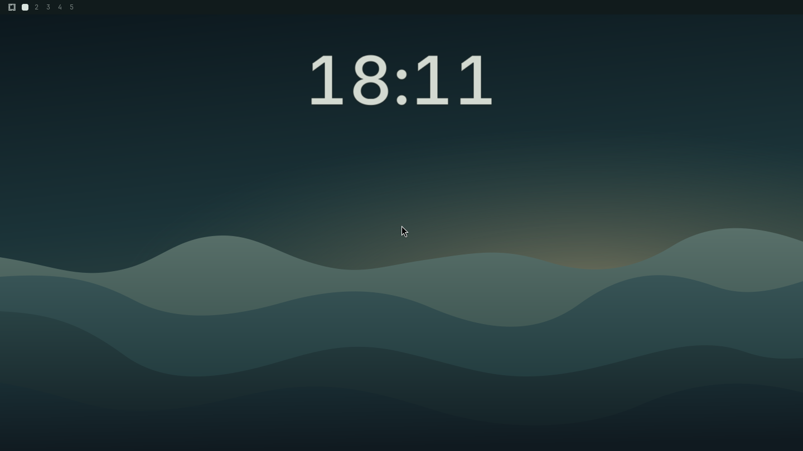

# Minute Ink

A large desktop clock for Omarchy. It sits below the top bar, above the wallpaper, and behind application windows. The digits brighten and grow slightly on hover. A soft shimmer and a short minute transition keep the clock readable. The clock follows the system motion preference, and the settings panel offers font search in English and Russian.



[Русская документация](docs/ru.md) · [Font settings screenshot](docs/font-settings.png)

## Requirements

Tested with Omarchy 4.5.0, Hyprland 0.56.2, Quickshell 0.3.2-r7 and Qt 6.12. Requires Python 3.11+ from the system. Python 3.13+ also detects wall-clock adjustments through Linux `timerfd`. The fallback checks for a change once a second. The bundled shader uses the Qt Quick graphics backend. Software rendering shows readable digits with reduced effects.

## Install

From an Omarchy session, review this repository and run:

```sh
omarchy plugin add https://github.com/i4w7w4a/omarchy-desktop-clock.git --enable
```

On first launch the clock appears on every connected display. The standard bar clock stays available. To change the font or language, open the settings panel:

```sh
omarchy shell shell summon io.github.i4w7w4a.desktop-clock '{}'
```

Choose **Font** and **Apply**. **Cancel** discards a pending font choice. **Русский / English** changes the panel language immediately.

### Desktop stacking

Minute Ink uses the Wayland Bottom layer and passes pointer input through to other surfaces. For a desktop with multiple widgets on that same layer, this optional Hyprland 0.56 Lua rule places Minute Ink ahead of widgets with lower priority:

```lua
hl.layer_rule({
  match = { namespace = "^i4w7w4a-desktop-clock$" },
  order = -2,
  no_anim = true,
})
```

Back up and edit your user Lua configuration if you need this rule. Run `hyprctl reload` and `hyprctl configerrors` after adding it.

## Remove

To keep a copy of your preferences, save the `io.github.i4w7w4a.desktop-clock` entry from `~/.config/omarchy/shell.json` before removing the plugin. Then run:

```sh
omarchy plugin remove io.github.i4w7w4a.desktop-clock
```

Remove the optional layer rule if you added it, then reload Hyprland. No separate service or autostart entry is installed.

## How it runs

The shell creates one small surface per output and launches one Python helper. The helper reads local time and queries Hyprland's local Unix socket for cursor position so the clock can react without capturing clicks. After 0.5 seconds without input, the check drops from 30 to 4 times per second by default. Input resumes fast checks. The plugin uses no network service. It writes font and language preferences only when you change them. Omarchy manages the plugin's enabled state.

`omarchy shell minuteInk status` prints the current state for diagnostics. Run `python3 -B -m unittest discover -s tests` to check time and cursor handling. The compiled shader is included. To rebuild it after editing `ClockInk.frag`, run `/usr/lib/qt6/bin/qsb --qt6 -o ClockInk.frag.qsb ClockInk.frag` with `qt6-shadertools` installed.

The code license is [MIT](LICENSE). Bundled Inter 4.1 is distributed under the [SIL Open Font License](fonts/OFL-Inter.txt). The preview images show this plugin on an isolated desktop.
